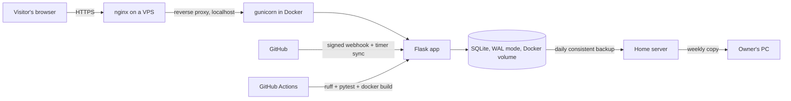

# itegin — personal site

**A self-hosted personal site: portfolio, GitHub showcase and a private learning section.**
Flask · SQLite · no JS frameworks · hosted on a VPS behind nginx.

🇷🇺 [Русская версия](README.ru.md) · [Live site](https://itgnroadmap.duckdns.org:9443/en?src=github) · [Itegin](https://github.com/Itegin) · [IT-Deck](https://github.com/Itegin/it-deck)

---

### What this is

The personal site of Itegin Baltabaev, Linux & Monitoring Engineer — written and run by me, from the code to the server. It started as a progress tracker for my own study plan and grew into a small platform: a public résumé page (Russian and English), a projects page, and a private learning section with courses and progress tracking. It is a real product I use daily, not a tutorial follow-along.

This repository is a **showcase only** — the source stays private (see [why](#why-the-source-is-private) below). It describes the project and links to the live site.

### Features

| | |
|---|---|
| **Public pages** | Résumé landing page (RU and EN) and a projects page; they send no cookies |
| **GitHub showcase** | Repos tagged `portfolio` are pulled in by a systemd timer and a signed webhook; READMEs go through an allow-list sanitizer, images are cached locally |
| **Project pages** | [IT-Deck](https://github.com/Itegin/it-deck) is presented section by section, built like a lesson: outline, reading ticks kept only in the browser |
| **Private learning section** | Courses with Markdown lessons, per-track progress and notes |
| **Access** | Hand-rolled auth (no flask-login), invite-only registration with single-use links stored only as hashes, admin role |
| **Admin panel** | Draft → publish for page sections, Markdown lesson editor with version history |
| **Analytics** | Page-view and referrer counter with no cookies and no raw IPs (HMAC'd daily visitor hash) |
| **Security** | CSRF tokens on every state-changing request, security headers, Content-Security-Policy (report-only for now) |
| **Smooth navigation** | No SPA: cross-document View Transitions and Speculation Rules (prerender) |
| **Progressive enhancement** | Forms are real HTML forms; JS only makes them faster |

### Stack

Flask 3 · Jinja · stdlib `sqlite3` (no ORM) · Markdown · gunicorn in Docker Compose · vanilla JS + hand-written CSS — no frontend framework, no bundler, no Tailwind.

CI on every push (GitHub Actions): `ruff check`, `pytest`, Docker build.

### Architecture

nginx terminates TLS and is the only thing exposed; the container binds to localhost. The database is backed up daily on the VPS, copied to a home server (my test bench), and from there weekly to my own PC.

### Why the source is private

This is a personal project I actively use and keep improving — the code isn't public, but the result is: the live site is open for anyone to look at. If you want to talk about how it's built, [reach out](https://github.com/Itegin).

---

© Itegin. Text and description in this repository are shared for reference; the linked application and its source are not licensed for reuse.
