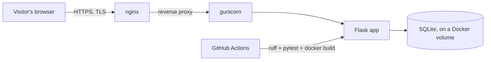

# PyGoDevOps-guide

**A self-hosted learning tracker for a Python → Go → DevOps study plan.**
12 phases · 77 lessons · per-track progress · built and run on my own home server.

🇷🇺 [Русская версия](README.ru.md) · [Live site](https://itgnroadmap.duckdns.org:9443/resume) · [Itegin](https://github.com/Itegin)

---

### What this is

A Flask site I built for myself to track progress through a personal "Python + Go → DevOps" study plan: 12 phases, 77 lessons, a checkbox per lesson, a progress bar per track. Each lesson is Markdown theory plus optional practice steps, verification steps and a self-check quiz. It's a real product I use daily, not a tutorial-follow-along — the codebase, auth, admin panel and CI are all mine.

This repository is a **showcase only** — the source stays private (see [why](#why-the-source-is-private) below). It exists to describe the project and link to the live, working site.

### Features

| | |
|---|---|
| **Multi-user** | Hand-rolled auth (no flask-login), session-based, admin role |
| **Guest mode** | One-click shared guest account to try the site without registering |
| **Progress tracking** | Per-track progress bars, checkbox per lesson, notes per lesson |
| **Lesson format** | Markdown theory + optional Practice / Verify steps + optional self-check quiz |
| **Admin panel** | Draft → publish workflow for editable page sections, field-by-field text editing |
| **Analytics** | Page-view counter with no cookies and no raw IPs (HMAC'd daily visitor hash) |
| **Progressive enhancement** | Every checkbox is a real HTML form; JS just makes it faster |

### Stack

Flask 3.1 · stdlib `sqlite3` (no ORM) · Markdown · gunicorn in Docker · vanilla JS + hand-written CSS — no frontend framework, no bundler, no Tailwind.

CI on every push: `ruff check`, `pytest`, Docker build.

### Architecture

The container binds to localhost only; nginx terminates TLS and is the only thing exposed. The whole stack runs on a home server, reached from outside despite CGNAT via an SSH tunnel.

### Why the source is private

This is a personal project I actively use and keep improving — the code isn't public, but the result is: the live site is open for anyone to look at. If you want to talk about how it's built, [reach out](https://github.com/Itegin).

---

© Itegin. Text and description in this repository are shared for reference; the linked application and its source are not licensed for reuse.
