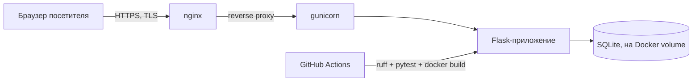

# PyGoDevOps-guide

**Самостоятельный трекер обучения по плану Python → Go → DevOps.**
12 фаз · 77 уроков · прогресс по трекам · написан и развёрнут на собственном домашнем сервере.

🇬🇧 [English version](README.md) · [Живой сайт](https://itgnroadmap.duckdns.org:9443/resume) · [Itegin](https://github.com/Itegin)

---

### Что это

Flask-сайт, который я написал для себя, чтобы отслеживать прогресс по личному плану обучения «Python + Go → DevOps»: 12 фаз, 77 уроков, чекбокс на урок, прогресс-бар по каждому треку. Каждый урок — это Markdown-теория плюс опциональные шаги практики, проверки и квиз-самопроверка. Это не «сделай по туториалу», а рабочий продукт, которым я пользуюсь ежедневно — код, аутентификация, админка и CI написаны мной.

Этот репозиторий — **только витрина**: исходники закрыты (почему — [ниже](#почему-исходники-закрыты)). Здесь описание проекта и ссылка на живой рабочий сайт.

### Возможности

| | |
|---|---|
| **Мультипользовательский** | Своя аутентификация (без flask-login), на сессиях, роль администратора |
| **Гостевой режим** | Общий гостевой аккаунт в один клик — можно попробовать сайт без регистрации |
| **Трекинг прогресса** | Прогресс-бары по трекам, чекбокс на урок, заметки к урокам |
| **Формат урока** | Markdown-теория + опциональные шаги Практики / Проверки + опциональный квиз-самопроверка |
| **Админка** | Черновик → публикация для редактируемых секций страниц, правка текста по полям |
| **Аналитика** | Счётчик просмотров без cookies и без хранения IP (HMAC-хеш посетителя за день) |
| **Progressive enhancement** | Каждый чекбокс — настоящая HTML-форма; JS только ускоряет |

### Стек

Flask 3.1 · стандартный `sqlite3` (без ORM) · Markdown · gunicorn в Docker · чистый JS + написанный вручную CSS — без фронтенд-фреймворка, без сборщика, без Tailwind.

CI на каждый пуш: `ruff check`, `pytest`, сборка Docker-образа.

### Архитектура

Контейнер слушает только localhost; nginx терминирует TLS и единственный смотрит наружу. Весь стек крутится на домашнем сервере, доступном снаружи несмотря на CGNAT через SSH-туннель.

### Почему исходники закрыты

Это личный проект, которым я активно пользуюсь и продолжаю дорабатывать — код закрыт, а вот результат открыт: живой сайт доступен всем. Если хочется обсудить, как это устроено — [пишите](https://github.com/Itegin).

---

© Itegin. Текст и описание в этом репозитории приведены для ознакомления; сама разработка и её исходный код не лицензированы для повторного использования.
