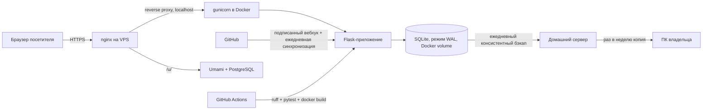

# itegin — personal site

**Личный сайт на своём хостинге: визитка, витрина GitHub и закрытый раздел обучения.**
Flask · SQLite · без JS-фреймворков · VPS за nginx.

🇬🇧 [English version](README.md) · [Живой сайт](https://itegin.com/?src=github) · [Itegin](https://github.com/Itegin) · [IT-Deck](https://github.com/Itegin/it-deck)

---

### Что это

Личный сайт Итегина Балтабаева, Linux & Monitoring Engineer — написан и поддерживается мной целиком, от кода до сервера. Начинался как трекер прогресса по моему учебному плану, а вырос в небольшую платформу: публичная визитка (на русском и английском), страница проектов и закрытый раздел обучения с курсами и отслеживанием прогресса. Это рабочий продукт, которым я пользуюсь ежедневно, а не «сделай по туториалу».

Этот репозиторий — **только витрина**: исходники закрыты (почему — [ниже](#почему-исходники-закрыты)). Здесь описание проекта и ссылка на живой сайт.

### Возможности

| | |
|---|---|
| **Публичные страницы** | Визитка (RU и EN) и страница проектов; cookies не ставят |
| **Витрина GitHub** | Репозитории с темой `portfolio` подтягиваются ежедневным systemd-таймером, подписанным вебхуком или кнопкой «Синхронизировать с GitHub» в админке; README проходит через санитайзер по белому списку, картинки кэшируются локально |
| **Страницы проектов** | [IT-Deck](https://github.com/Itegin/it-deck) подан по разделам и построен как урок: оглавление, отметки «прочитано» хранятся только в браузере |
| **Закрытый раздел обучения** | Курсы с уроками в Markdown, прогресс по трекам и заметки |
| **Доступ** | Своя аутентификация (без flask-login), регистрация только по приглашению (одноразовые ссылки, в базе только хеш), роль администратора |
| **Админка** | Черновик → публикация для разделов страниц, редактор уроков в Markdown с историей версий |
| **Аналитика** | Счётчик просмотров и источников без cookies и без хранения IP (HMAC-хеш посетителя за день) |
| **Аналитика Umami** | Своя установка, без cookies; панель доступна только через SSH-туннель; данные хранятся 12 месяцев |
| **Ключи IT-Deck** | Админка выдаёт ключи [IT-Deck](https://github.com/Itegin/it-deck), подписанные Ed25519; подписанный список отозванных лежит в `/keys/it-deck/revoked.json` |
| **Безопасность** | CSRF-токены на каждый изменяющий запрос, заголовки безопасности, Content-Security-Policy (пока в режиме report-only) |
| **Плавная навигация** | Без SPA: кросс-документные View Transitions и Speculation Rules (предзагрузка) |
| **Progressive enhancement** | Формы — настоящие HTML-формы; JS только ускоряет |

### Стек

Flask 3 · Jinja · стандартный `sqlite3` (без ORM) · Markdown · gunicorn в Docker Compose · чистый JS + написанный вручную CSS — без фронтенд-фреймворка, без сборщика, без Tailwind.

CI на каждый пуш (GitHub Actions): `ruff check`, `pytest`, сборка Docker-образа.

### Архитектура

nginx терминирует TLS и единственный смотрит наружу; контейнер слушает только localhost. База бэкапится раз в сутки на VPS, копируется на домашний сервер (мой тестовый стенд), а оттуда раз в неделю — на мой ПК.

### Почему исходники закрыты

Это личный проект, которым я активно пользуюсь и продолжаю дорабатывать — код закрыт, а вот результат открыт: живой сайт доступен всем. Если хочется обсудить, как это устроено — [пишите](https://github.com/Itegin).

---

© Itegin. Текст и описание в этом репозитории приведены для ознакомления; сама разработка и её исходный код не лицензированы для повторного использования.
